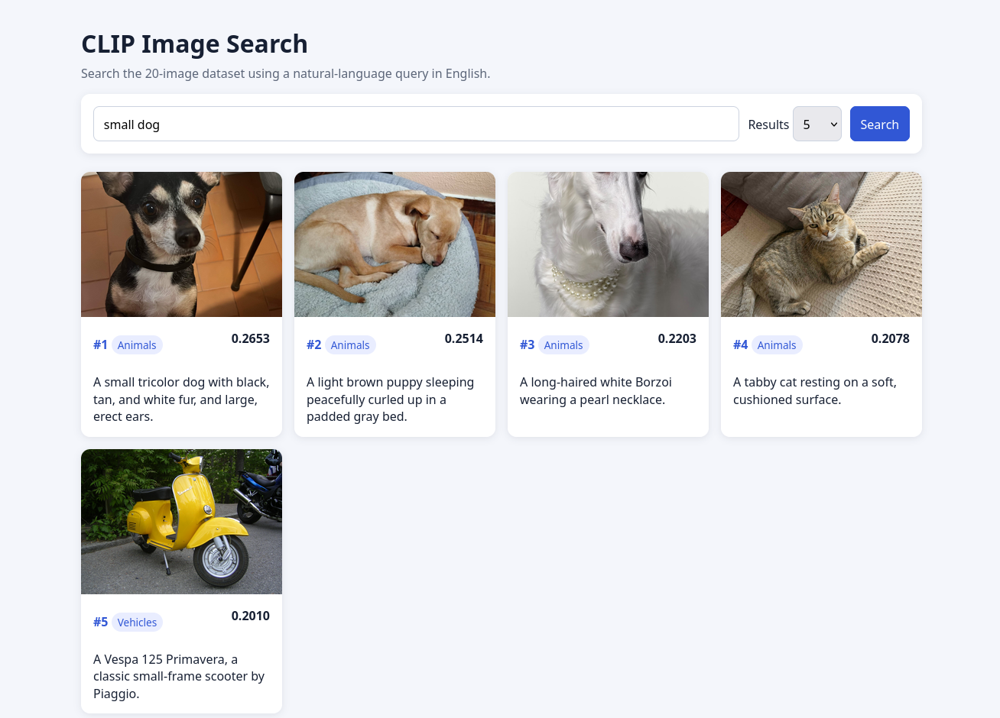

# Pre-CLIP, CLIP y buscador multimodal

La práctica compara dos modelos independientes (Pre-CLIP), evalúa un modelo multimodal CLIP y construye un buscador semántico sobre un dataset propio.

El proyecto se desarrolló y probó en Debian GNU/Linux 13 (Trixie) y se ejecuta mediante Docker sobre Python 3.12. La configuración utiliza PyTorch y Torchvision para el procesamiento de imágenes, Transformers para CLIP y Sentence-Transformers para los embeddings de texto. Todos los experimentos funcionan en CPU, los pesos de los modelos se descargan automáticamente y se almacenan en la caché de Docker.

## Dataset

El dataset contiene 20 imágenes reales, organizadas en cuatro categorías con cinco imágenes cada una:

- Animals
- Food
- Vehicles
- Landscapes

Las imágenes y sus captions en inglés están descritas en [`assets/dataset.json`](assets/dataset.json). Las imágenes se encuentran en:

```text
assets/animals/
assets/food/
assets/vehicles/
assets/landscapes/
```

Las imágenes y captions fueron seleccionadas y redactadas para esta práctica, no se generan durante la ejecución del código.

## Requisitos

- Docker
- Make

La práctica está configurada para ejecutarse en CPU. Los pesos de los modelos se descargan automáticamente la primera vez y se conservan en el volumen Docker `p4-cache`.

## Construcción y comprobación del entorno

```bash
make build
make run
```

`make run` ejecuta el test de dependencias [`src/entorno_test.py`](src/entorno_test.py). También se puede ejecutar otro script con:

```bash
make run SCRIPT=src/validate_dataset.py
```

## Validar el dataset

```bash
make run SCRIPT=src/validate_dataset.py
```

La validación comprueba cuatro categorías, cinco elementos por categoría, 20 imágenes, 20 captions, rutas existentes y ausencia de IDs o rutas duplicadas.

## Pre-CLIP

```bash
make run SCRIPT=src/preclip.py
```

El script usa:

- `torchvision.models.resnet18` con pesos preentrenados para las imágenes.
- La red se utiliza como extractor de características eliminando su cabeza clasificadora, el resultado tiene 512 dimensiones.
- `sentence-transformers/distiluse-base-multilingual-cased` para las captions.

Los dos modelos se entrenaron por separado y sus vectores no se comparan directamente mediante coseno. El análisis compara las matrices de similitud internas de cada modalidad mediante:

- correlación de Spearman entre sus similitudes por pares
- solapamiento de los tres vecinos más cercanos
- similitud media interna por categoría.

El resultado se guarda en [`results/preclip_results.json`](results/preclip_results.json).

Resultado obtenido en la ejecución actual:

```text
Image embedding dimension: 512
Text embedding dimension: 512
Within-modality similarity Spearman correlation: 0.3547
Nearest-neighbor overlap at k=3: 0.5667
```

## CLIP

```bash
make run SCRIPT=src/clip_experiment.py
```

Se utiliza `openai/clip-vit-base-patch32`. Imagen y caption se transforman con el mismo modelo y se comparan dentro del espacio multimodal compartido.

El resultado se guarda en [`results/clip_results.json`](results/clip_results.json). La ejecución actual produjo:

```text
Embedding dimension: 512
Top-1 matching accuracy: 0.9500
Mean reciprocal rank: 0.9750
Mean correct-pair similarity: 0.3156
```

CLIP colocó la caption correcta en primera posición para 19 de las 20 imágenes.

## Buscador multimodal

Para ejecutar una consulta individual:

```bash
make run SCRIPT="src/search.py --query 'small dog' --k 3"
```

Para abrir el buscador interactivo:

```bash
make run SCRIPT=src/search.py
```

Durante la ejecución:

- escribe una consulta libre en inglés
- usa `:k 3` para cambiar el número de resultados
- usa `exit` o `quit` para terminar.

Ejemplo de consulta:

```text
Query> mountain landscape
```

El índice de embeddings de imágenes se guarda en [`results/clip_image_index.npz`](results/clip_image_index.npz). Las imágenes se calculan una sola vez y las consultas posteriores reutilizan el índice, para cada consulta solo se obtiene el embedding textual y se calcula el ranking por similitud coseno.

### Interfaz web

Además del CLI, se incluye una interfaz web sencilla para explorar el buscador desde un navegador:

```bash
make web
```

Después, abre <http://localhost:8000>. La interfaz permite escribir una consulta en inglés, seleccionar `k` y visualizar las imágenes como miniaturas junto con su categoría, caption y puntuación. El servidor carga el modelo y el índice una sola vez al arrancar, cada consulta solo procesa el texto.

El CLI se mantiene como respaldo reproducible y no se ha eliminado.

## Ejemplo de uso



La interfaz permite introducir una consulta en inglés y obtener un ranking de imágenes
con sus puntuaciones de similitud.

## Organización del código

- [`src/validate_dataset.py`](src/validate_dataset.py): valida el manifiesto y los archivos del dataset.
- [`src/preclip.py`](src/preclip.py): ejecuta el experimento con ResNet18 y Sentence-Transformers.
- [`src/clip_experiment.py`](src/clip_experiment.py): calcula embeddings y métricas CLIP.
- [`src/search.py`](src/search.py): índice y buscador semántico interactivo.
- [`src/web_app.py`](src/web_app.py): interfaz web del buscador.
- [`src/entorno_test.py`](src/entorno_test.py): comprueba las versiones instaladas y la disponibilidad de CUDA.

## Interpretación de los resultados

Pre-CLIP no dispone de un espacio compartido: ResNet18 representa contenido visual y Sentence-Transformers representa lenguaje. Por eso la comparación válida se hace sobre las relaciones y los ordenamientos dentro de cada modalidad.

CLIP se entrena para alinear imágenes y texto en un espacio común. En consecuencia, sí es válido calcular la similitud coseno entre una imagen y una caption, y usarla directamente para recuperar imágenes a partir de consultas textuales.
